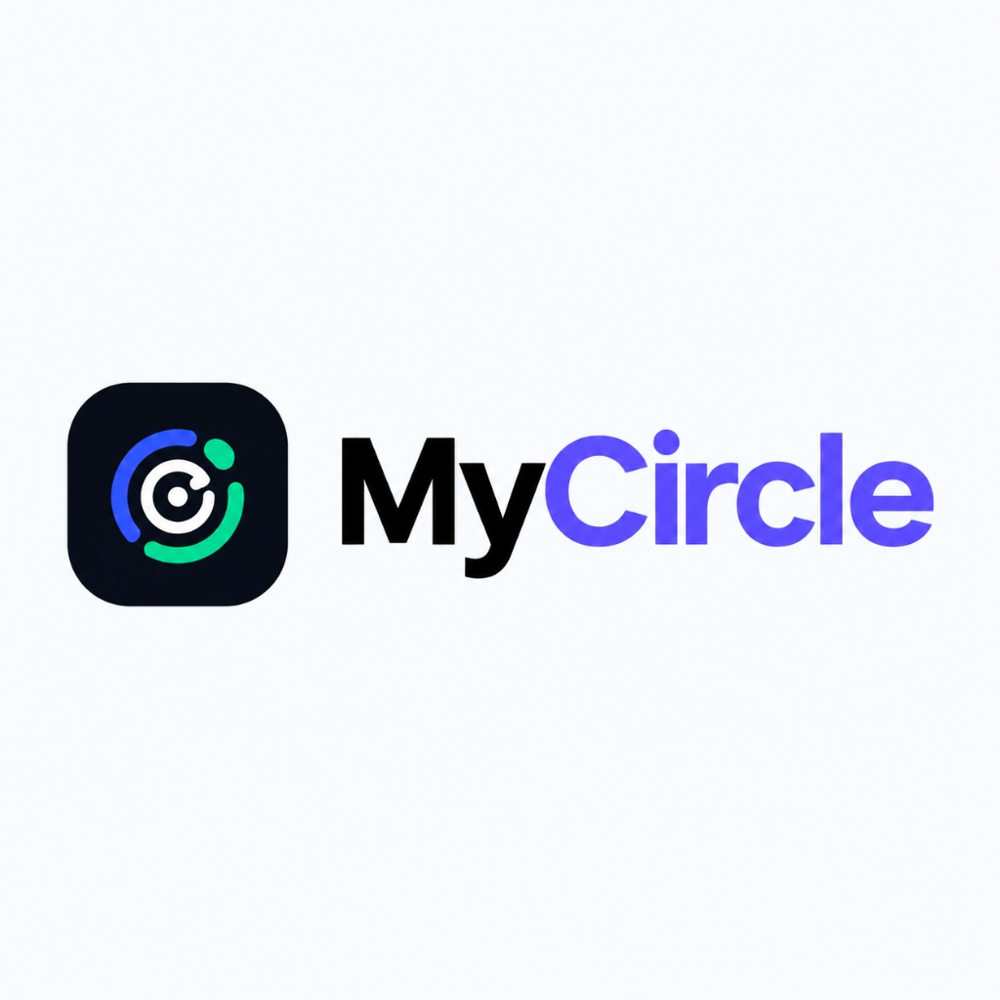
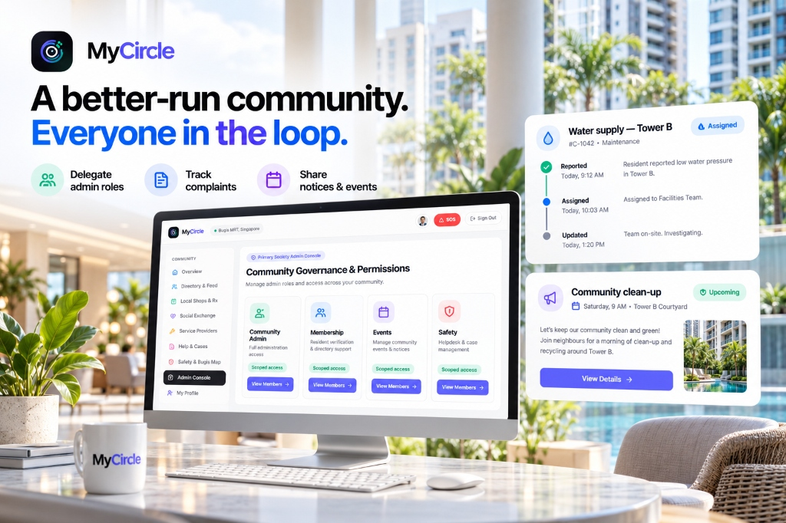
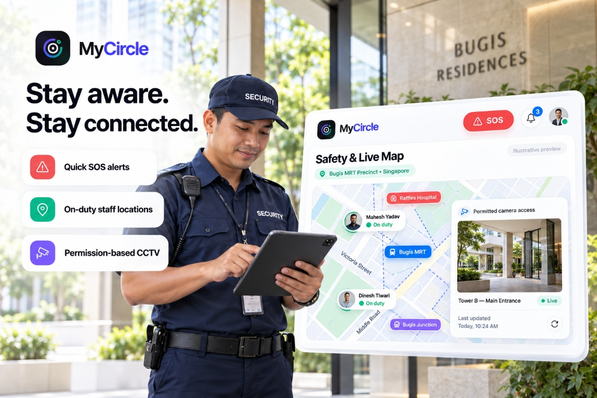
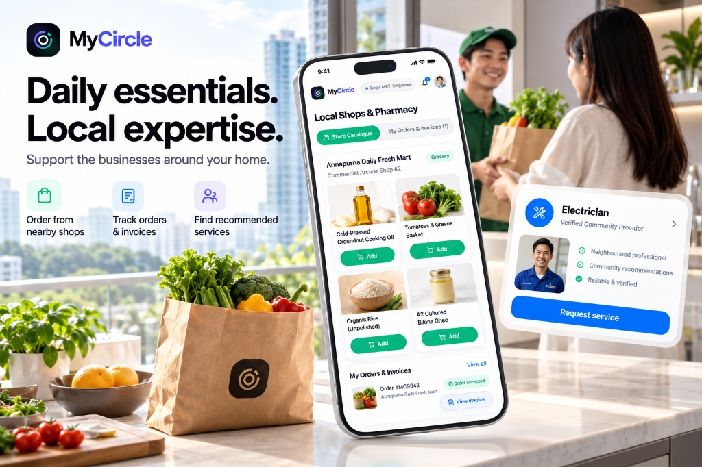
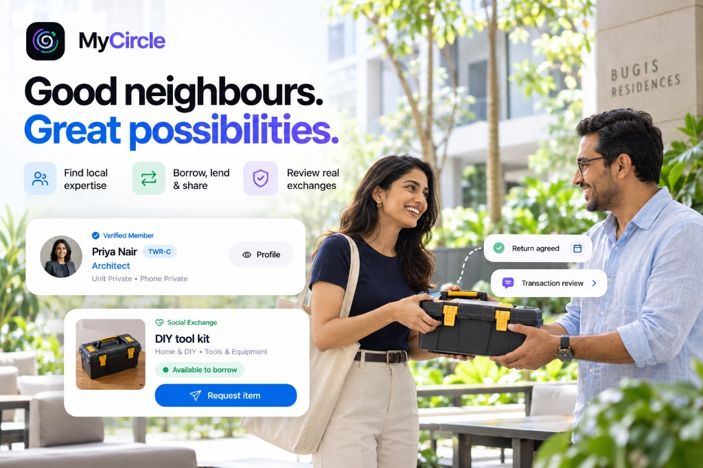

<p align="center">
  
</p>

<h1 align="center">MyCircle — Trusted Residential Community OS</h1>

<p align="center">
  <strong>The Private, Trusted Operating System for Modern Residential Communities</strong><br />
  <em>Version 1.0.1 • Developed by <strong>Malini Kochar</strong></em>
</p>

<p align="center">
  <a href="https://www.youtube.com/watch?v=jgpNHm1oluc">
    
  </a>
  
  
  
  
</p>

---

## 📺 App Demo Video

Experience the full walkthrough of **MyCircle v1.0.1** covering user authentication, admin delegation, live Singapore Bugis MRT staff radar, local shop orders, peer-to-peer sharing, and privacy controls:

[](https://www.youtube.com/watch?v=jgpNHm1oluc)

> 🔗 **Direct YouTube Link**: [https://www.youtube.com/watch?v=jgpNHm1oluc](https://www.youtube.com/watch?v=jgpNHm1oluc)

---

## 🌟 Key Features & Visual Showcase

### 1. Community Governance & Role Delegations
> *A better-run community. Everyone in the loop.*

Scoped permissions allowing primary admins to delegate specific duties (Membership Verification, Complaints, Events, Facility Safety) to 10 sub-admins without exposing private member data.

<p align="center">
  
</p>

---

### 2. Safety, Live Patrol Radar & Singapore Bugis MRT Map
> *Stay aware. Stay connected.*

Real-time telemetry showing on-duty security responders (Head Guard Mahesh Yadav & Guard Dinesh Tiwari) around **Bugis Residences @ Victoria, Singapore (`1.3006° N, 103.8559° E`)**, alongside landmarks (Bugis MRT EW12/DT14, Raffles Hospital, Bugis Junction, DUO Tower), quick hold-to-send SOS alerts, and permission-audited CCTV.

<p align="center">
  
</p>

---

### 3. Local Commerce, Medicine Delivery & Verified Services
> *Daily essentials. Local expertise.*

Hyper-local convenience and pharmacy ordering with 15-minute delivery, prescription verification (Rx gating), mandatory buyer approval for price adjustments, and verified neighborhood technician booking.

<p align="center">
  
</p>

---

### 4. Social Exchange & Circular Economy Sharing
> *Good neighbours. Great possibilities.*

Borrow, lend, donate, or swap household tools (drills, ladders, event chairs) with verified neighbors, complete with custody agreements, condition reports, and dual-blind 14-day reviews.

<p align="center">
  
</p>

---

## 🔐 Test Login Credentials (`/login`)

Sign in at `http://localhost:3000/login` with any of the accounts below, or use the **One-Click Demo Login** accordion:

| Role / Persona | Display Name | Username | Email (`@ensure.in`) | Password | Target Workspace |
| :--- | :--- | :--- | :--- | :--- | :--- |
| **Primary Admin** | Aarav Mehta | `admin` | `admin@ensure.in` | `MyCircle@Admin2026` | `/workspaces/admin` |
| **Approved Resident #1** | Priya Nair | `priya` | `priya@ensure.in` | `MyCircle@User2026` | `/` & `/account` |
| **Approved Resident #2** | Dr. Rohan Kulkarni | `rohan` | `rohan@ensure.in` | `MyCircle@User2026` | `/social-service` |
| **Sub-Admin #1 (Membership)** | Neha Deshmukh | `neha_admin` | `neha.admin@ensure.in` | `MyCircle@SubAdmin2026` | `/workspaces/admin` |
| **Sub-Admin #10 (Safety & CCTV)** | Col. Pratap Chauhan | `safety_admin` | `safety.admin@ensure.in` | `MyCircle@SubAdmin2026` | `/safety` |
| **Local Shop Owner** | Suresh Agarwal | `freshmart` | `shop@ensure.in` | `MyCircle@Shop2026` | `/workspaces/shop` |
| **Licensed Pharmacist** | Dr. Zoya Merchant | `pharmacist` | `pharmacy@ensure.in` | `MyCircle@Shop2026` | `/workspaces/shop` |
| **Service Provider** | Ramesh Vishwakarma | `ramesh_elec` | `provider@ensure.in` | `MyCircle@Service2026` | `/workspaces/provider` |
| **Security & SOS Staff** | Mahesh Yadav | `mahesh_guard` | `security@ensure.in` | `MyCircle@Staff2026` | `/workspaces/staff` |
| **Pending Applicant (Gate Test)** | Vikram Sethi | `pending_user` | `pending@ensure.in` | `MyCircle@User2026` | `/` (Access Gate) |

---

## 🏆 Neighborhood Hacks 2026 Documentation

MyCircle was developed for **[Neighborhood Hacks 2026 on Devpost](https://neighborhood-hacks-2026.devpost.com/)** by **Malini Kochar**. Complete technical documentation, architectural specifications, and live test reports are available below:

- 📋 **[Neighborhood Hacks Devpost Submission Dossier](docs/HACKATHON_DEVPOST.md)**: Full project narrative, problem statement, community social-good alignment, architecture, challenges overcome, and roadmap.
- 🧪 **[Acceptance & Verification Test Report](docs/TEST_REPORT.md)**: Live logs of 23 Vitest acceptance tests running against Supabase Postgres 17 with 0 errors and 0 warnings.
- 📊 **[Requirement Implementation Status Tracker](docs/IMPLEMENTATION_STATUS.md)**: Requirement-by-requirement mapping of all PRD specifications across all 7 modules.
- 📐 **[Architectural Decisions & Schema Plan](docs/DECISIONS.md)**: Multi-tenant topology, Singapore Bugis telemetry, RLS design, and state machines.
- 🛡️ **[Permission, Privacy & Isolation Matrix](docs/PERMISSIONS.md)**: RLS policies, 10 sub-admin delegations, and dual-projection privacy boundaries.
- 🔌 **[External Integrations & Adapter Status](docs/INTEGRATIONS.md)**: Resend.com transactional email engine, Leaflet radar telemetry, and Supabase integration matrix.

---

## 🛠️ Tech Stack & Architecture

- **Framework**: [Next.js 16 (App Router)](https://nextjs.org/) + React 19 + TypeScript
- **Styling**: Tailwind CSS + Apple Cupertino Aesthetics (`#F5F5F7` canvas, frosted glass `backdrop-blur-2xl bg-white/80`, `#0071E3` accents)
- **Database & Auth**: [Supabase Postgres 17](https://supabase.com) with Row-Level Security & Stored Procedures
- **Email Notifications**: [Resend](https://resend.com) with 7 transactional HTML templates
- **Maps & Geolocation**: Dual-mode Bugis Radar & OpenStreetMap Leaflet Engine
- **Verification**: Vitest test suite with 23 comprehensive acceptance tests

---

## 🚀 Local Setup

```bash
# 1. Clone the repository
git clone https://github.com/malinikochar/mycircle.git
cd mycircle

# 2. Install dependencies
npm install

# 3. Start development server
npm run dev
```

Open [http://localhost:3000](http://localhost:3000) to view the application.

### Run Verification & Tests

```bash
npm run typecheck   # TypeScript type verification
npm test            # Run all 23 Vitest acceptance tests
npm run build       # Next.js optimized production build
```

---

<p align="center">
  <strong>MyCircle OS v1.0.1</strong><br />
  App Developed with ❤️ by <strong>Malini Kochar</strong>
</p>
