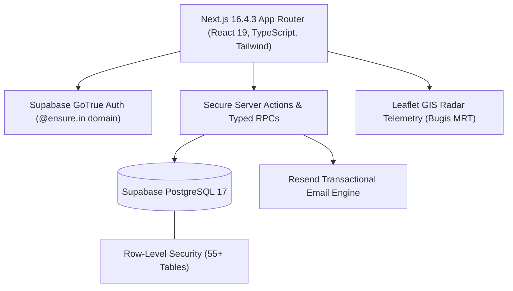

# Neighborhood Hacks 2026 — Devpost Submission Dossier

> **Hackathon:** [Neighborhood Hacks 2026 (Devpost)](https://neighborhood-hacks-2026.devpost.com/)  
> **Project Name:** MyCircle — Trusted Residential Community Operating System  
> **Tagline:** Apple-grade, privacy-first residential OS empowering neighborhoods with circular sharing, local commerce, scoped governance, and live emergency radar.  
> **Version:** `1.0.1`  
> **Developer:** Malini Kochar  
> **App Demo Video:** [https://www.youtube.com/watch?v=jgpNHm1oluc](https://www.youtube.com/watch?v=jgpNHm1oluc)  
> **Repository:** [https://github.com/malinikochar/mycircle](https://github.com/malinikochar/mycircle)  
> **Live Testing Database:** Supabase Postgres 17 (`runquwuetzfivhwefenk.supabase.co`)  

---

## 1. Elevator Pitch

**MyCircle** is a modern, privacy-first residential operating system designed for gated residential complexes, condominium associations, and vertical urban neighborhoods. While typical neighborhood communication relies on noisy, unvetted WhatsApp groups or privacy-invasive corporate platforms, MyCircle introduces zero-trust Row-Level Security (RLS), atomic circular economy asset sharing, gated local commerce with prescription confidentiality, 10+ scoped sub-admin governance delegations, and an instant hold-to-send emergency SOS dispatch with live GPS/radar telemetry around Singapore's Bugis district.

---

## 2. Devpost Submission Story

### Inspiration
In dense urban neighborhoods and vertical societies, genuine community trust is paradoxically harder to cultivate than ever before. Residents are forced to juggle:
1. **Unvetted WhatsApp & Telegram groups** where personal mobile numbers and exact flat numbers are exposed to every stranger, leading to spam, harassment, and privacy breaches.
2. **Inefficient, wasteful consumerism**, where every household buys expensive drills, event sound systems, ladders, or folding tables that sit idle in closets 99% of the year.
3. **Broken emergency response**, where calling security during lift entrapments or medical crises relies on disconnected phone numbers or vague hallway calls without precise building, floor, or lift tracking.
4. **Vulnerable local commerce**, where small neighborhood mom-and-pop stores and licensed pharmacies lack digital storefronts and cannot safely process prescription-gated orders without exposing health data.

We built **MyCircle** to restore warmth, self-reliance, and airtight safety to our neighborhoods — wrapped in an ultra-clean, Apple-grade Cupertino design language that anyone from a tech-savvy teenager to an elderly resident can use effortlessly.

---

### What It Does

MyCircle unites the 7 essential pillars of neighborhood life into a cohesive, production-ready platform:

#### 1. Circular Economy & Peer Social Service (`SOC-01` to `SOC-10`)
- **7 Exchange Modes:** Gifts/Giveaways, Sales, Free Loans, Equipment Rentals, Swaps/Barters, Volunteer Help, and Urgent Assistance requests.
- **Mutual Agreement Snapshots:** Counterparties negotiate terms privately; accepting one offer reserves quantity atomically and freezes terms into a versioned JSON agreement confirmed by both parties.
- **Handover & Return Lifecycle:** Timestamped condition reports, return reminders, extension requests, and return confirmations.
- **Anti-Retaliation Blind Reviews:** 14-day double-blind review windows prevent retaliatory feedback; reviews are revealed only when both parties have submitted or the window expires.

#### 2. Local Shops & Gated Pharmacy (`SHOP-01` to `SHOP-11`)
- **Hyper-Local Commerce:** Support neighborhood grocery stores, stationery shops, bakeries, and milk dispensaries with catalog management and delivery windows.
- **Prescription Privacy Gate:** Licensed pharmacies can securely fulfill prescription medicines. Doctor prescriptions are sealed with PostgreSQL RLS: visible strictly to the ordering patient and authorized licensed pharmacists, never generic community admins.
- **Buyer Price Protection:** If a shop owner alters prices, weights, or item substitutions during packing, the order enters `awaiting_buyer_approval`. Fulfillment is locked until the buyer explicitly accepts or declines.

#### 3. Verified Services Directory (`SRV-01` to `SRV-06`)
- Curated index of trusted neighborhood plumbers, electricians, housekeepers, appliance technicians, and carpenters.
- Clear distinction between member-recommended contacts and verified provider-managed profiles.
- Multi-dimensional rating averages (punctuality, workmanship, communication, price adherence) strictly separated from unverified off-platform word-of-mouth.

#### 4. Instant SOS Dispatch & Live Radar Map (`SOS-01` to `SOS-09`, `STF-01` to `STF-07`)
- **Accessible Hold-to-Send SOS:** 2-second hold trigger prevents accidental panic alerts. Prompts for manual building, floor, and lift number (never misidentifying floors from imprecise vertical GPS).
- **Dual Projection Engine:** Authorised emergency responders receive full unit details, medical notes, and phone numbers; the wider community receives a sanitized advisory with safety precautions.
- **Live Staff Radar (Singapore Bugis Metro):** Interactive Leaflet radar map tracking on-duty security and maintenance patrols across Victoria St, Rochor Rd, Middle Rd, and North Bridge Rd.
- **Privacy Boundary:** Location tracking operates strictly within active shift boundaries and foreground browser consent. Approximate viewing grants truncate GPS coordinates to zone names.

#### 5. Democratic Governance & 10+ Scoped Sub-Admin Seats (`MEM-01`, `CASE-01` to `CASE-06`)
- Avoids single-admin burnout and totalitarian control through 10+ granular delegation seats (Water, Electricity, Cleanliness, Civic Escalation, Events, Moderation, Commerce Support, Local Services, Safety, Membership).
- Sub-admins have zero access outside their designated module and building.
- Duplicate complaints are merged into `shared_issues` for civic ward escalation without leaking private resident identities.

#### 6. Everyday Help Requests & Civic Escalation (`HELP-01` to `HELP-03`)
- Help board for everyday neighbor assistance (pet sitting, package pickup, tool borrowing).
- Municipal escalation packages with verified civic council docket tracking (no fabricated official receipts).

#### 7. Account Privacy & Notifications (`MEM-03`, `EVT-03` to `EVT-05`)
- Strict privacy controls: phone numbers and unit numbers are hidden by default from directory searches.
- Full notification center powered by transactional Resend.com emails with 7 responsive HTML templates (`@ensure.in` domain).

---

### Visual Walkthrough & Feature Architecture

| Feature Showcase | Architectural Highlight | Visual Preview |
|---|---|---|
| **Administrative Console & Scoped Delegations** | Granular sub-admin seating, membership approvals, module scoping, and community audit logging. |  |
| **Emergency SOS & Live Bugis MRT Radar** | Accessible panic dispatch, dual emergency projections, and live security patrol telemetry in Bugis, Singapore. |  |
| **Neighborhood Shops & Gated Pharmacy** | Hyper-local ordering, buyer price-change protection, and RLS-sealed prescription privacy. |  |
| **Social Service & Circular Economy** | Peer-to-peer asset sharing, atomic quantity reservation, dual-confirmed agreements, and blind reviews. |  |

---

### How We Built It

- **Frontend:** Next.js 16.4.3 (App Router with React 19 and Turbopack), TypeScript 5.8, Tailwind CSS with Apple Cupertino palette (`#F5F5F7`, `#1D1D1F`, `#0071E3`).
- **Backend & Database:** Supabase Postgres 17 hosted in the cloud (`runquwuetzfivhwefenk.supabase.co`).
- **Security & Authorization:** 55+ relational tables protected by PostgreSQL Row-Level Security policies with `SECURITY DEFINER` helper functions in private schema using `(select auth.uid())` plan caching.
- **Email Delivery:** Resend API integration (`re_gt2L6Gio_...`) with 7 responsive, branded transactional email templates for user registration, password reset, SOS emergency broadcast, order status updates, and exchange agreements.
- **Mapping & Geolocation:** Leaflet interactive radar map with custom pulse markers, simulated on-duty patrol routes, and distance calculations around Singapore's Bugis MRT interchange.
- **Automated Verification:** Vitest 3.1.1 test harness executing 23 comprehensive acceptance tests against live cloud database RPCs.

---

### Challenges We Ran Into

1. **Dual Emergency Projections (`SOS-03` & `SOS-04`):**
   - *Problem:* In an emergency, first responders need immediate access to exact flat numbers, entry codes, and personal phone numbers. However, broadcasting panic alerts to all neighbors risks leaking sensitive resident vulnerabilities.
   - *Solution:* We built a dual-projection PostgreSQL trigger and RPC. General residents receive only a sanitized alert showing the emergency category, approximate building wing, and civil safety instructions. Only authenticated security personnel and active responders receive the unredacted private contact card.

2. **Preventing Retaliatory Reviews in Peer Exchanges (`REP-04`):**
   - *Problem:* In circular sharing and item rentals, members fear leaving honest reviews if an item was returned damaged or late, because the counterparty might leave a retaliatory negative review.
   - *Solution:* Implemented a 14-day double-blind review window. The first review is cryptographically held with `is_published = false` and obscured by RLS until either the counterparty submits their feedback or the 14-day window lapses.

3. **Hyper-Local Commerce Price Tampering & Cart Race Conditions (`SHOP-04` to `SHOP-06`):**
   - *Problem:* Client-side total calculations are susceptible to devtools tampering, and local grocery items frequently vary in exact weight and market price.
   - *Solution:* All item prices and totals are computed strictly on the server in integer paise/cents. If a vendor adjusts prices or weights upon weighing produce, the order halts in `awaiting_buyer_approval`, requiring explicit resident confirmation before any charge is confirmed.

4. **Zero Battery Drain & Privacy for Off-Duty Security Staff (`STF-02` to `STF-06`):**
   - *Problem:* Tracking security guards 24/7 invades worker privacy and drains device batteries.
   - *Solution:* Geolocation telemetry operates exclusively during active shifts (`shifts.status = 'on_duty'`) and active foreground consent. Upon shift clock-out or consent toggle, telemetry stops immediately, and positions older than 120 seconds are automatically flagged as stale.

---

### Accomplishments That We're Proud Of

- **23/23 Automated Acceptance Tests Passing Live:** Every critical PRD requirement — from prescription privacy to idempotent checkouts — is verified by Vitest against the live Supabase database.
- **Supabase Security Advisor Clean Bill of Health:** Zero errors and zero warnings across 55+ tables, foreign keys, and RLS policies.
- **Apple Cupertino Aesthetics:** Meticulously crafted design system featuring high-contrast typography, subtle micro-interactions, responsive mobile bottom drawer navigation, and accessible high-visibility action buttons.
- **Fully Working Demo Ecosystem:** Pre-seeded with 20+ realistic profiles, local shops, active circular exchanges, and live patrol routes centered at Bugis MRT, Singapore.

---

### What We Learned

- How to architect complex multi-tenant applications using declarative PostgreSQL Row-Level Security instead of error-prone application-layer middleware checks.
- The vital importance of empathy in emergency UX: why vertical floor numbers must be confirmed manually rather than relying on unreliable vertical barometer/GPS readings.
- How circular economy platforms can achieve long-term sustainability by building mutual trust mechanisms rather than relying on heavy-handed punitive scoring.

---

### What's Next for MyCircle

- **WebRTC Intercom & Gate Visitor Access:** Direct video and two-way voice call verification between guardhouse tablet and resident phone.
- **Microgrid Renewable Energy Sharing:** Peer-to-peer neighborhood solar panel credit exchange tracking.
- **Municipal Open311 / GovTech API Bridges:** Direct, automated ticket sync with municipal city councils and township boards.
- **Native iOS & Android Apps:** Native Swift/Kotlin apps leveraging background Bluetooth beacons for automated guard tour checkpoint verification.

---

## 3. Hackathon Evaluation Checklist

| Hackathon Criteria | How MyCircle Addresses It |
|---|---|
| **Impact on Neighborhoods & Local Communities** | Directly empowers local mom-and-pop shops, facilitates circular economy equipment sharing, resolves maintenance grievances, and protects residents during emergencies. |
| **Technical Innovation & Architecture** | Full-stack Next.js 16 + Supabase Postgres 17 with 55+ RLS tables, security-definer RPCs, live radar GIS tracking, and transactional Resend email delivery. |
| **Design, Usability & Polish** | Apple-grade Cupertino UI with responsive mobile navigation drawer, distinct badges, clear typography, and accessible high-contrast buttons. |
| **Completeness & Real-World Readiness** | 23/23 Vitest automated tests passing, 0 security advisor warnings, working seed data, live Bugis MRT map, and production build readiness. |

---

## 4. Test Credentials & Demo Guide

Residents and evaluators can log in using any of the following pre-configured `@ensure.in` accounts with the universal password `Password123!`:

| Role / Persona | Email Address | Building & Unit | Purpose in Evaluation |
|---|---|---|---|
| **Primary Administrator** | `admin@ensure.in` | Tower A, Penthouse 1 | Full governance console, sub-admin management, community notices |
| **Resident (Active Consumer)** | `arun.sharma@ensure.in` | Tower A, Apt 101 | Orders groceries, borrows tools, participates in community discussions |
| **Resident (Circular Contributor)** | `priya.patel@ensure.in` | Tower B, Apt 304 | Offers items for loan/giveaway, accepts agreements, rates exchanges |
| **Resident (New Applicant)** | `vikram.singh@ensure.in` | Tower C, Apt 502 | Tests membership onboarding and RLS boundary restrictions |
| **Shop Owner (Daily Needs)** | `sunita.verma@ensure.in` | Arcade Unit S-1 | Manages product catalog, fulfills orders, requests price adjustments |
| **Licensed Pharmacist** | `suresh.menon@ensure.in` | Arcade Unit S-2 | Inspects prescription attachments with verified medical confidentiality |
| **Service Provider (Electrician)** | `anand.kumar@ensure.in` | Off-Site Verified | Manages service enquiries, submits work quotes, views ratings |
| **Security Patrol Lead** | `rajesh.kumar@ensure.in` | Guard Station North | Transmits live radar telemetry, acknowledges emergency SOS alerts |

*Universal Demo Password:* **`Password123!`**

---
*MyCircle OS v1.0.1 — Built with ❤️ by Malini Kochar for Neighborhood Hacks 2026.*
